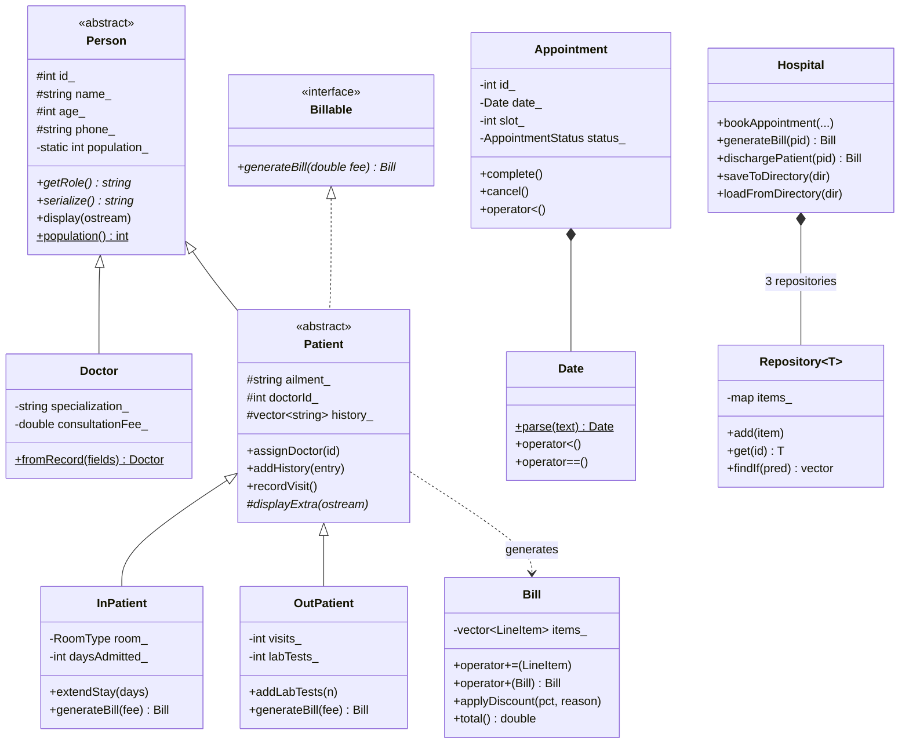

# 🏥 Hospital Management System (C++17, OOP)

A console-based Hospital Management System written in modern C++ to demonstrate
**Object-Oriented Programming**: abstraction, encapsulation, inheritance (single,
multiple, multilevel, hierarchical), runtime polymorphism, operator overloading,
templates, exception handling and file persistence.

Every push is built and tested automatically on Linux, Windows and macOS by
GitHub Actions (see the **Actions** tab).

## Features

| Area | What you can do |
|---|---|
| Registration | Add doctors, register out-patients, admit in-patients (General / Semi-Private / Private rooms) |
| Appointments | Book 1-hour slots (09:00–17:00) with automatic **double-booking detection** for doctor and patient, complete or cancel them |
| Treatment | Record doctor's notes into the patient's medical history, order lab tests, extend hospital stay |
| Billing | Type-specific bills (per-day room + nursing for in-patients, per-visit + lab tests for out-patients), automatic 10% senior-citizen discount, itemised printout |
| Discharge | Final bill, cancels pending appointments, removes the patient |
| Reports | List / search doctors by specialization, sorted appointment schedule, patient history, hospital statistics |
| Persistence | All data is saved to plain-text files in `data/` and reloaded on the next run |

## OOP concepts and where to find them

| Concept | Where |
|---|---|
| **Abstraction** (abstract class) | `Person` – pure virtual `getRole()` and `serialize()`; `Patient` stays abstract |
| **Interface** | `Billable` – only a pure virtual `generateBill()` |
| **Encapsulation** | Private/protected data with validating setters (`Person::setPhone`, `Doctor::setFee`, …) |
| **Single inheritance** | `Doctor : Person` |
| **Multiple inheritance** | `Patient : Person, Billable` |
| **Multilevel / hierarchical inheritance** | `Person → Patient → InPatient / OutPatient` |
| **Runtime polymorphism** | `patient->generateBill(fee)`, `display()`, `serialize()`, `recordVisit()` through base pointers |
| **Template method pattern** | `Patient::display()` calls the subclass hook `displayExtra()` |
| **Operator overloading** | `Bill +=`, `Bill +`, `Date <`, `Date ==`, `Appointment <`, `operator<<` for every entity |
| **Friend functions** | `operator<<` in `Person`, `Bill`, `Date`, `Appointment` |
| **Class template** | `Repository<T>` stores `Doctor`, `Patient` and `Appointment` |
| **Member function template** | `Repository<T>::findIf(Predicate)` (used with lambdas) |
| **Static members** | `Person::population()` live-object counter, `InPatient::roomRate()`, fee constants |
| **Composition** | `Hospital` owns three repositories (HAS-A) |
| **Exception hierarchy** | `HospitalException → NotFound / Validation / SchedulingConflict` |
| **RTTI** | `std::dynamic_pointer_cast<OutPatient>` before ordering lab tests |
| **Factory pattern** | `PatientFactory::fromRecord()` rebuilds the right subclass from a file |
| **RAII / smart pointers** | `std::shared_ptr` everywhere, no manual `new`/`delete`; copy disabled on `Person` |

## Class diagram



A PNG copy is in [`docs/class-diagram.png`](docs/class-diagram.png).

## Project structure

```
hospital-management-system/
├── include/              # Class declarations (.h)
│   ├── Person.h          # abstract base class
│   ├── Doctor.h
│   ├── Billable.h        # interface
│   ├── Patient.h         # abstract, Person + Billable
│   ├── InPatient.h
│   ├── OutPatient.h
│   ├── PatientFactory.h
│   ├── Appointment.h
│   ├── Bill.h
│   ├── Date.h
│   ├── Repository.h      # class template (header-only)
│   ├── Hospital.h        # facade
│   ├── Exceptions.h
│   └── Utils.h
├── docs/class-diagram.png
├── src/                  # Implementations (.cpp) + main.cpp (menu & demo)
├── tests/
│   └── test_hospital.cpp # 27 unit tests, no external framework
├── .github/workflows/
│   └── build.yml         # CI: Linux, Windows, macOS
├── Makefile
└── CMakeLists.txt
```

## Build and run

Requires a C++17 compiler (g++ 9+, clang 10+, or Visual Studio 2019+).

**Option 1 – Make (Linux / macOS / Windows with MinGW)**
```bash
make            # builds ./hms
make demo       # scripted walkthrough of every feature
make test       # runs the unit tests
./hms           # interactive menu
```

**Option 2 – CMake (any OS, any IDE)**
```bash
cmake -S . -B out
cmake --build out
ctest --test-dir out          # tests
./out/hms --demo              # Windows: out\Debug\hms.exe --demo
```

**Option 3 – single command, no build tools**
```bash
g++ -std=c++17 -Iinclude src/*.cpp -o hms
```

### Command-line options

| Option | Meaning |
|---|---|
| *(none)* | Interactive menu, data stored in `./data` |
| `--demo` | Runs a scripted scenario showing every feature |
| `--data DIR` | Use another folder for saved data |
| `--help` | Usage |

## Sample output

```
=== 6. Polymorphic billing (same call, different behaviour) ===
----------------------------------------------------
 BILL: In-Patient Lakshmi Iyer (ID 1002)
----------------------------------------------------
 Doctor consultation                     Rs. 750.00
 Semi-Private room x 5 day(s)          Rs. 15000.00
 Nursing care x 5 day(s)                Rs. 2500.00
 Senior citizen discount (10%)         Rs. -1825.00
----------------------------------------------------
 TOTAL                                 Rs. 16425.00
----------------------------------------------------

=== 4. Exception handling ===
  Caught SchedulingConflictException -> Scheduling conflict: Dr. Farah Khan is already booked on 15-10-2026 at 10:00-11:00
  Caught NotFoundException          -> Not found: Patient with ID 4242
```

## Billing rules

| Patient type | Charges |
|---|---|
| In-patient | Consultation (once) + room rate × days + nursing Rs. 500 × days. Rooms: General Rs. 1,500, Semi-Private Rs. 3,000, Private Rs. 5,000 per day |
| Out-patient | Registration Rs. 100 + consultation × completed visits + Rs. 350 per lab test |
| Age 60+ | 10% senior-citizen discount on the total |

## Saved data format

Plain text, one record per line, `|`-separated (so it can be inspected or edited by hand):

```
data/doctors.txt       101|Anita Rao|48|9840012345|Cardiology|900
data/patients.txt      OUT|1003|Arjun Nair|29|9790033333|Chest pain|101|<history>|1|2
data/appointments.txt  2|1003|101|15-10-2026|11|1
```
